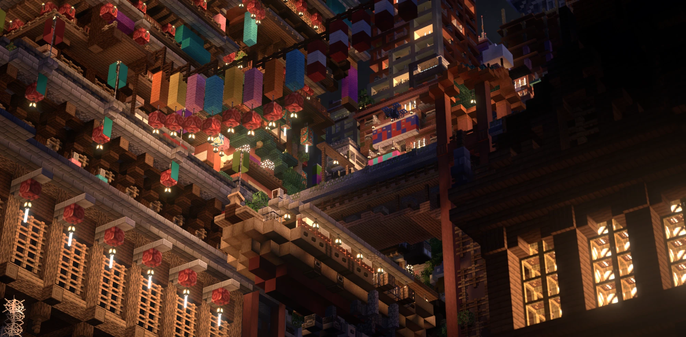
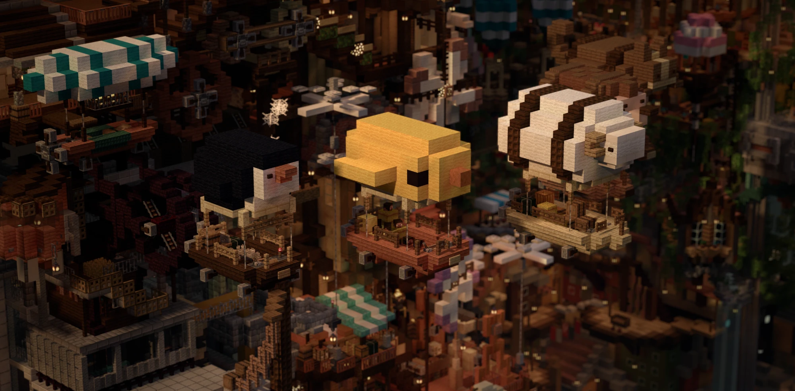
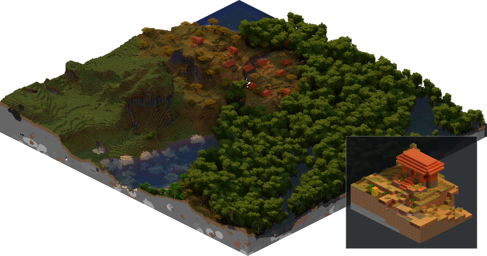
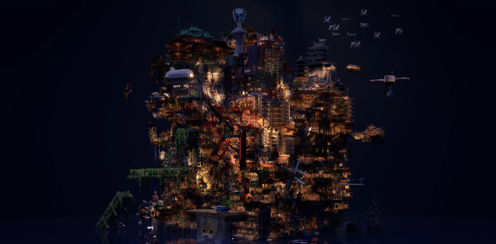

# prism

A 3D map of a Minecraft Java Edition world for the browser, with the light
baked in: sun shadows for any time of day, sky light, block light from
torches and lanterns, and sunlight bounced off nearby faces. It reads the
blocks and textures from the client jar, bakes on the CPU only, and writes a
static site.

Experimental, and rough in places:

- Water is naive: a flat surface with made-up ripples, which mirrors only
  what is on the screen (and the sky where that runs out).
- The haze and the ground mist are tuned by eye on a few maps; close to
  the water they can be too thick.
- Far off, the map turns into coarse cells of mean colour, so distant
  views are blocky.
- Mobs, item frames, paintings and the text on signs are not drawn, and
  moving blocks are shown still (see [Limitations](#limitations)).
- It has mostly been tried in Chrome, and a bake takes up to 2 GB of
  memory.

The output has a format number. When an update changes it, the viewer says
so and the map has to be baked again.

<p>
  
  
</p>

Viewed in real time in Chrome.

The map in them is "IHOU", not part of this project (see [License](#license)).

## Building

Requires Linux, GCC (C11), GNU make and zlib (`sudo apt install
build-essential zlib1g-dev` on Debian / Ubuntu).

```bash
make
```

This builds `build/prism`, `build/skinlist` and the libraries under
`libs/` they use. The default flags include `-march=native`.

## Baking a world

```bash
build/prism map ~/.minecraft/versions/26.2/26.2.jar \
    ~/.minecraft/saves/MyWorld out/mymap
```

This bakes each region file into `out/mymap/r.<x>.<z>/` and lists them in
`out/mymap/map.json`. The second argument is the world's folder or the
folder of its overworld's region files. `--threads n` sets the thread
count (default: all cores). A region file or chunk that cannot be read (a
damaged save) is left empty, with a warning.

Run it again after the world has changed and it bakes only what changed.
That is each region whose file changed, plus each neighbour whose margin
holds a changed chunk (by the chunk timestamps in the region files). If
`prism` was rebuilt, it bakes everything. Each bake goes to a new folder
that replaces the old one once it is done, so a map being served is never
half updated. A viewer that is open at the time notices (by `tiles.bin`'s
`Last-Modified`, or its index having changed) and loads the region again.
A region with nothing new in the same second as its bake started may be
baked once more on the next run.

Player heads show their skins when the skins are on disk.
`scripts/fetch_skins.sh <region dir> out/skins` downloads them from
`textures.minecraft.net`. The bake itself never goes online; a head whose
skin is missing keeps its block's own texture.

## A picture instead (2.5D)



A savanna village in a survival world at sunset, a 290 x 280-block area
drawn with `--scale 8 --ss 2 --ymin 48 --sun 160` in about 2.5 s (scaled
down here). Inset, one of its houses in the morning, with `--scale 32 --ss 2
--sun 50`.

```bash
build/prism iso ~/.minecraft/versions/26.2/26.2.jar \
    ~/.minecraft/saves/MyWorld -300 -300 300 300 area.png --scale 4
```

draws the world from x, z = -300, -300 to 300, 300 (both corners inside)
as an isometric PNG on the CPU, with the same mesh and baked light as the
viewer at one time of day. How it is drawn, its memory use, and how to put
neighbouring pictures together: [docs/iso.md](docs/iso.md).

| Option | |
|---|---|
| `--sun deg` | The sun along its arc: 0 sunrise, 90 noon, 180 sunset, past that the moon (default 136.4) |
| `--scale px` | Pixels a block, 1-64 (default 16); below 16 the textures are filtered down |
| `--ss n` | n x n samples a pixel, 1-4 (default 1): smoother edges |
| `--ymin y` | The lowest level drawn (default -64, the world's bottom) |
| `--bounce-rays n` | Rays the bounced sun is gathered over at each corner, 1-48 (default 16; the bake's 48 is a little smoother and slower) |
| `--threads n` | Default 16 |
| `--noshadow` | Baked shadows only, no shadow map |

## Viewing

Copy the viewer next to the map and serve the folder over HTTP:

```bash
cp -r viewer/* out/
cd out && python3 -m http.server 8000
```

Then open `http://localhost:8000/index.html?map=mymap`. The viewer loads
three.js 0.160 from the jsDelivr CDN, so the browser needs internet access.

The viewer fetches only the parts of each region's `tiles.bin` it needs,
with HTTP Range requests. Static hosts and web servers such as nginx,
Apache, GitHub Pages and S3 support these. Python's `http.server` does not:
the viewer then downloads each region's whole file once, which is fine
locally but wasteful over the internet.

To put the viewer in a page of your own, or serve the map from another
site, see [docs/embedding.md](docs/embedding.md).

### Controls

- Drag to orbit, right-drag to pan, and use the wheel (or the bar on the
  right) to zoom.
- WASD (or the on-screen pad) moves, Q/E go down/up, and Shift goes faster.
  When you stop, the orbit turns about what is in the middle of the screen.
- **V** or the person button switches to fly mode; the picture stays as
  it was in orbit. Click to capture the mouse (Esc releases it). W flies
  where the view points, Space/E and Shift/Q go up/down, and the wheel sets
  the speed.
- The time-of-day bar at the top left sets the sun (06:00 sunrise, 18:00
  sunset, the moon by night); **[** and **]** step it, and **T** or ▶ lets
  the day go by.
- **F** toggles the effects (grading, bloom, tilt-shift, light shafts),
  which are on to begin with.
- **C** or CAM opens the camera panel: focal length, exposure, white
  balance and aperture.
- **P** saves a photo, up to 4× the screen size. **H** hides the controls.
  **?** or the ? button lists all of this.
- The corner button puts the viewer full screen (where a browser cannot, as on
  an iPhone, it fills the window); Esc leaves.

### URL parameters

The view is kept in the address, so a reload or a shared link opens the same
place. Embedded, the same names are `createViewer`'s options.

| Parameter | Meaning |
|---|---|
| `map=<dir>` | The baked map to load |
| `cam=x,y,z`, `at=x,y,z` | Camera position and target, in world coordinates |
| `sun=<deg>` | Sun angle: 0 sunrise (east), 180 sunset, 180–360 night |
| `fly=1`, `fov=<deg>` | Fly mode, field of view |
| `fx=0` | Start with the effects off |
| `ev=`, `wb=`, `fstop=`, `mini=1` | Exposure, white balance, aperture, miniature blur |
| `wave=`, `ripple=` | Plant sway and water ripple strength (0 = still) |
| `rays=`, `mist=`, `stars=`, `bloom=`, `sat=` | Light shafts, ground mist, stars, bloom and saturation strength |
| `shadow=0` | No live shadow map, only the baked shadows |
| `sunspeed=` | How fast the day goes by with **T**, in degrees a second (1: a day in 6 minutes) |
| `pr=`, `budget=` | Fixed pixel ratio; most quads drawn, in millions (8; 2 on a phone or with 4 GB or less) |
| `diag`, `diag&bench` | Diagnostics on screen; with `bench`, frame timings once the tiles are in |
| `glb=<file>` | A single region's `region.glb` (from `prism bake ... glb`) instead of a map |

## How it works

`prism` loads one region plus a 32-block margin, so faces at the edges cull
and shadows fall in from the neighbours. It meshes the blocks with their
models from the jar and bakes light at every quad corner:

- **Sun:** where along its arc the sun is visible.
- **Sky:** how much of the sky the corner sees.
- **Block light:** rays to the light sources, so torches cast shadows.
- **Bounce:** sunlight reflected off the lit faces around the corner.

The viewer then lights each corner for wherever the sun is. A live shadow
map adds the hard shadows of small things nearby: steps, fences, grass.

Each region is cut into 64-block tiles at three levels of detail:

| Level | Contents | Shown |
|---|---|---|
| 0 | Everything | Up to 192 blocks away |
| 1 | No small plants, opaque leaves | Up to 640 blocks away |
| 2 | 4×1×4-block cells of mean colour | Beyond that |

What a bake writes, and how it finds the water level and leaves out caves:
[docs/format.md](docs/format.md).

Measured on an AMD Ryzen 7 9800X3D (8 cores, 16 threads) under WSL2 with
15 GB of memory, baking every region of the world with `prism map`:

| | IHOU (the pictures above) | A survival world |
|---|---|---|
| What it is | One dense build, from the water at y 5 up to y 255, on a flat world | Natural terrain |
| Regions | 25 (1 with the build) | 35 |
| World size (region files) | 78 MB | 180 MB |
| Bake time | 75 s (8.7 CPU-minutes) | 3 min 2 s (25 CPU-minutes) |
| Peak memory | 1.8 GB | 1.4 GB |
| Output size | 34 MB | 261 MB |

Peak memory is that of the busiest region, whatever the thread count, as
`prism map` bakes one region at a time; it grows with how much there is to
draw, not with the world's size. The output grows with what is drawn: the
survival world's regions take about 7 MB each, an empty one almost nothing.
The viewer downloads only what it shows: on a 4-region test map, opening
on an overview took 7–37 MB, depending on the view, and getting closer
downloads more of what is near.

Where things are in the source: [docs/developing.md](docs/developing.md).

## Limitations

- Linux only. Overworld only.
- Entities (mobs, item frames, paintings, armour stands, boats, minecarts)
  are not drawn, nor is the text on signs.
- Barriers, light blocks and structure voids are not drawn; they are
  invisible in the game too.
- Some blocks are drawn as they stand still: a block a piston was moving
  when the world was saved, settled where it was going (the game finishes
  the move as soon as the world loads), an active conduit as an
  inactive one (its shell), end portals and gateways with one still of
  their starfield (in the game it slides with the camera), and a dragon's
  jaw and a piglin's ears at rest. Copper golem statues' eyes don't glow.
- Chunks compressed with LZ4 (the server's `region-file-compression=lz4`)
  or too large for the region file (kept in `.mcc` files) are not read.
  The bake prints a warning for each region file with chunks it could not
  read, and leaves them empty.
- Baking needs up to about 2 GB of memory, since a region at a time is held
  in full (its blocks and light). `prism map` warns when less is free.
- `prism map` does not notice a neighbour's edge chunk being deleted
  (only saved), so after trimming a world, bake it into a new folder.

## License

The code is under the MIT License (`LICENSE`). The IHOU pictures in
`docs/` are not: they show a map made by others, under its own terms.



The map is "IHOU" (違法建築), built by 168 players at the Minecraft違法建築イベント
of マインクラフト建築コミュニティ (@mc_kenchiku_com) in January 2020.
It is not part of this project and was not made by us: the world, its terms and its
download are at
<http://blog.livedoor.jp/mc_kenchiku_com/archives/1076765264.html>.
